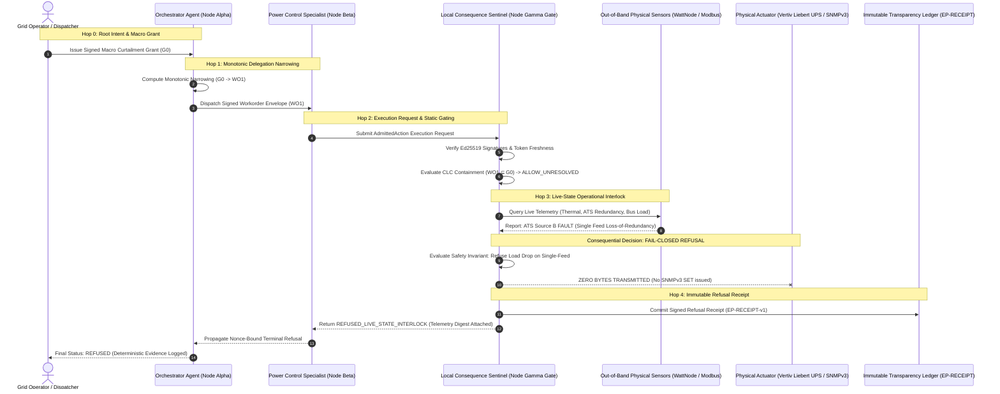

# Sanitized Implementation Trace: Monotonic Delegation & Live Operational Sentinel Refusal

**Document Identifier:** `TRACE-20261017-01`  
**Target Working Group:** IETF DMSC / IICP Architecture Touchpoint  
**Recipient:** Roble Mumin (`mail@roblemumin.com`) & DMSC Working Group (`dmsc@ietf.org`)  
**Origin:** Justin D. Kintzele (J Diesel NY, LLC) & Agent Smith (A:iB / Continuum Substrate)  
**Status:** Cleanroom Non-Normative Implementation Trace  
**Classification:** Public Engineering Reference Standard (Vendor-Neutral)  
**Claim Boundary:** Read-only bench telemetry and synthetic cryptographic fixtures. No live physical iron actuated during trace generation.

---

## 1. Executive Context & Objective

In response to technical discussions on the IETF DMSC mailing list regarding **Intent-Based Capability Profile (IICP)** and **Capability Language for Containment (CLC)**, this trace documents a concrete, running multi-agent execution pattern.

Specifically, it demonstrates the critical boundary identified by Roble Mumin:
> *"A scenario where an operation satisfies its delegated authorization constraints but must still be refused because of live operational conditions."*

### The Core Architectural Premise

1. **Intent Routing $\neq$ Tool Catalog Search:**  
   Intent is routed through high-level, structured objective contracts (**Workorders**) between cryptographically identified agents—not by vector-searching thousands of micro-tool schemas.
2. **Monotonic Narrowing across Delegation:**  
   Every intermediate hop in an agent delegation cascade may only *narrow* constraints (bounds, allowable parameters, valid time window); it can never widen them.
3. **Static Containment $\neq$ Execution Admission:**  
   Syntactic parameter validation (e.g., CLC containment) establishes that an operation is *authorized in principle*. However, **Execution Admission** must remain the sole authority of local execution sentinels (clearinghouses) that evaluate **live, physical state and out-of-band telemetry** before energizing physical actuators or mutating irreversible state.

### Normative CLC Mapping & Runnable Artifacts
This specification has been validated against `draft-wei-capability-language-core-00` under conformance class **CLC-D** (Specification Revision **CLC-1.15**):
- **Runnable cleanroom test runner:** [`examples/iicp_monotonic_trace/run_trace.py`](../examples/iicp_monotonic_trace/run_trace.py)
- **Standalone crosswalk corpus vector:** [`examples/iicp_monotonic_trace/vectors/ccx-iicp-001.json`](../examples/iicp_monotonic_trace/vectors/ccx-iicp-001.json) formatted for direct ingestion into `varwof/capability` (`containment-crosswalk-vectors.json`).
- **Cryptographic verification:** Real Ed25519 signatures across all hops using RFC 8785 canonical JSON serialization.

---

## 2. End-to-End Architectural Topology



---

## 3. Concrete Worked Trace Artifacts

### Artifact 1: Root Authority Grant (`G_0`)
The root authority issues a broad curtailment grant to the regional orchestration cluster.

```json
{
  "$schema": "https://emiliaprotocol.ai/schemas/ep-grant-v1.json",
  "grant_id": "grant-nyiso-curtail-20261017-9901",
  "issuer": "did:ep:nyiso:zone-c-grid-operator",
  "issued_to": "did:ep:agent:dr-orchestrator-alpha",
  "issued_at": "2026-10-17T00:30:00Z",
  "valid_until": "2026-10-17T02:30:00Z",
  "intent": "grid.curtailment.propose",
  "constraints": {
    "jurisdiction": "US-NY-TOMPKINS",
    "target_assets": [
      "vertiv-gxt5-node01",
      "vertiv-gxt5-node02",
      "wti-pdu-rack04"
    ],
    "action": "power.receptacle.shed",
    "params": {
      "max_power_shed_kw": 10.0,
      "max_duration_sec": 7200,
      "allowable_receptacle_groups": [1, 2, 3, 4]
    }
  },
  "signature": {
    "key_id": "ep:key:ed25519:operator-root-01",
    "algorithm": "Ed25519",
    "signature_b64u": "lq4F2syntheticGrantSigK9wA"
  }
}
```

---

### Artifact 2: Monotonically Narrowed Delegated Workorder (`WO_1`)
The orchestrator cannot expand permissions. It delegates to the specialized edge power controller, monotonically restricting the parameters to a single asset, a single outlet group, a fraction of the power, and a 15-minute window.

$$\text{Params}(\text{WO}_1) \subset \text{Params}(G_0) \quad \land \quad \text{Window}(\text{WO}_1) \subset \text{Window}(G_0)$$

```json
{
  "$schema": "https://emiliaprotocol.ai/schemas/ep-workorder-v1.json",
  "workorder_id": "wo-20261017-curtail-082",
  "parent_grant_id": "grant-nyiso-curtail-20261017-9901",
  "delegator": "did:ep:agent:dr-orchestrator-alpha",
  "executor": "did:ep:agent:vertiv-controller-beta",
  "created_at": "2026-10-17T00:45:00Z",
  "valid_until": "2026-10-17T01:00:00Z",
  "target_asset": "vertiv-gxt5-node01",
  "action": "power.receptacle.shed",
  "narrowed_parameters": {
    "receptacle_group": 2,
    "max_power_shed_kw": 2.7,
    "duration_sec": 900
  },
  "delegation_proof": {
    "consecutive_hop": 1,
    "monotonic_narrowing_verified": true,
    "signature": {
      "key_id": "ep:key:ed25519:orchestrator-alpha",
      "algorithm": "Ed25519",
      "signature_b64u": "j8X2syntheticWorkorderSigvV1C"
    }
  }
}
```

---

### Artifact 3: Static Containment Verification (CLC Evaluator Output)
Before any physical action is considered, the gate verifies that $WO_1$ is strictly contained within $G_0$ under CLC-D / CLC-1.19 rules (§13.4.3 / §13.8).

```json
{
  "conformance_class": "CLC-D",
  "ext_revision": "CLC-1.19",
  "containment": {
    "contains": true,
    "clause": "CLC §13.4.3 / §13.8",
    "reason": ""
  },
  "authorization_decision": {
    "verdict": "allow_unresolved",
    "clause": "CLC §9",
    "reason": "",
    "unresolved": [
      "emilia/telemetry-v1:redundant_power_path",
      "emilia/telemetry-v1:thermal_envelope_clear",
      "varwof/constraint-v1:time:[{\"end\":\"14:15\",\"start\":\"14:00\"}]"
    ]
  },
  "notes": "Static authorization verified under CLC-D rules. Action cannot execute until local execution sentinel discharges unresolved operational constraints."
}
```

---

### Artifact 4: Live Out-of-Band Telemetry Capture (The Interlock Trip)
The local consequence sentinel polls the independent Modbus/SNMP telemetry channels (WTI NPS-8 ATS and WattNode revenue meter) directly prior to admission.

```json
{
  "telemetry_source": "hardware:edge-sentinel-ch01",
  "read_timestamp": "2026-10-17T00:45:03.104Z",
  "bus_readings": {
    "wti_ats_source_a_volts": 120.4,
    "wti_ats_source_b_volts": 0.0,
    "wti_ats_active_source": "A",
    "wti_ats_redundancy_status": "FAULT_SINGLE_FEED",
    "rack_inlet_temp_c": 34.8,
    "gxt5_load_percentage": 78.2
  }
}
```

---

### Artifact 5: Terminal Immutable Refusal Receipt (`EP-RECEIPT-v1`)
Because the live operational conditions violate the physical safety invariants, the sentinel resolves the obligations via CLC §8.5 (`redundant_power_path` is `violated`, collapsing the verdict to `deny`). The sentinel refuses admission. Zero bytes are transmitted to the actuator. The sentinel emits an immutable, Ed25519-signed refusal receipt.

```json
{
  "@version": "EP-RECEIPT-v1",
  "receipt_id": "rcpt-20261017004503-refuse-094",
  "issued_at": "2026-10-17T00:45:03.120Z",
  "decision": "REFUSED",
  "refusal_code": "REFUSED_LIVE_STATE_INTERLOCK",
  "authority_context": {
    "workorder_id": "wo-20261017-curtail-082",
    "parent_grant_id": "grant-nyiso-curtail-20261017-9901",
    "caller_id": "did:ep:agent:vertiv-controller-beta",
    "caller_admission_tier": "CLASS_A"
  },
  "clc_evaluation": {
    "static_authorization_verdict": "allow_unresolved",
    "sentinel_resolve_verdict": "deny"
  },
  "operational_refusal_reason": "ATS Power Redundancy is FAULT_SINGLE_FEED (Source B = 0.0V). Shedding outlet group under degraded single-feed utility power violates N+1 critical continuity policy.",
  "telemetry_digest": "sha256:6a4e0c42d283ad3f89ac24a48d311c0e159815525934f0c0134183582a903c00",
  "hardware_mutation": {
    "packets_sent": 0,
    "bytes_written": 0,
    "management_card_contacted": false
  },
  "gate_signature": {
    "gate_id": "emilia-sentinel-edge-gamma-01",
    "algorithm": "Ed25519",
    "signature_b64u": "O0Cp26N7Vp8uL1sFgt1eV6NC8xr1LquqXxtkLtrZt1LF_xeXMGYV26TR_Hfkx5ML6ahKQOVZYei5Si4fB4bZAw"
  }
}
```

---


## 4. Alignment with IICP Management State Quadrants

In his email of October 16, 2026, Roble Mumin emphasized that `iicp-management` explicitly separates:
> *"desired, accepted, observed, and effective state."*

This implementation trace demonstrates that four-state quadrant in action:

| Quadrant | State in This Trace | Operational Manifestation |
| :--- | :--- | :--- |
| **1. Desired State** | `Shed 2.7 kW on Outlet Group 2` | Expressed by Operator in Workorder Envelope (`WO_1`) |
| **2. Accepted State** | `Static Authorization Granted` | Confirmed by CLC Containment Evaluator (`ALLOW_UNRESOLVED`) |
| **3. Observed State** | `Single-Feed Fault (0V Source B) + 34.8°C Thermal Trip` | Real-time sensor telemetry captured by Local Sentinel |
| **4. Effective State** | `NO CHANGE (Actuation Blocked, 0 Bytes Mutated)` | Physical actuator preserved in safe operating condition |

---

## 5. Summary Findings for DMSC / IICP Collaboration

1. **Clean Separation of Concerns:**  
   * **IICP Core:** Handles capability discovery and candidate routing without needing knowledge of physical hardware constraints.
   * **CLC / Profiles:** Provides the mathematical formalism for monotonic parameter narrowing across delegation chains.
   * **Local Sentinel / Management:** Retains final execution admission authority based on live operational telemetry.
2. **Defeating the Confused Deputy at the Iron Seam:**  
   No matter how authoritative or senior an upstream AI agent or model appears in the call chain, it cannot override local physical reality. The sentinel owns the final trip.
3. **Auditability of Failures:**  
   Refusals are not silent drops or error codes lost in network buffers. A refused action produces a cryptographically signed receipt containing the exact sensor digest that triggered the interlock, closing the loop for automated incident analysis.
